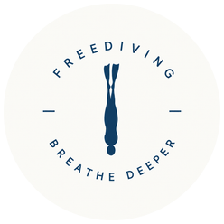

# breathe deeper · Balance 2 陆上静态闭气

面向 Amazfit Balance 2 的 Zepp OS 小程序，提供三套陆上静态闭气训练、心率与有效血氧读数、训练记录和历史最佳成绩。



## 快速开始

开发环境：Node.js 与 npm，以及官方 Zeus CLI。本项目曾在 Node.js 24、Zeus CLI 1.9.3 下验证。

```powershell
npm install -g @zeppos/zeus-cli
npm ci
npm test
npm run build
```

真机预览先运行 `zeus login`，然后在项目根目录运行：

```powershell
zeus preview -t "Amazfit Balance 2"
```

使用 Zepp App 扫描生成的预览二维码。二维码有有效期，旧二维码不随仓库发布。

## 项目结构

- `page/gt/home/`：手表界面、表冠交互、传感器与震动调用。
- `utils/training.js`：训练方案、计时状态和记录计算。
- `tests/`：训练逻辑与模拟设备 API 测试。
- `assets/`：手表图标与资源。
- `design/`：图标设计源文件和制作说明。
- `scripts/preview-qr.cjs`：将 Zeus 预览二维码保存为 PNG 的可选辅助工具。
- `app.json`：应用信息、权限及设备配置。

## 1.0.7 使用流程

首页显示历史最佳闭气时长和创下日期时间；选择训练表可查看全部 8 轮，再确认开始整次训练。

- CO₂ 间歇表、阶梯时长表：确认开始后进入 00:05 准备倒计时，随后自动闭气 → 恢复 → 下一轮闭气。准备结束仍有提示；闭气结束进入恢复不再震动；恢复只在剩余 00:30、00:10、00:05 时各单次短振，恢复归零不再震动；全程不需要逐轮点击。第 8 轮恢复结束后保存并展示本次结果。
- 自由计时：进入准备页后按下表冠开始闭气，正计时；再次按下表冠保存本轮并立即开始恢复。恢复期间表冠不能跳过倒计时。恢复在剩余 00:30、00:10、00:05 时各单次短振，结束后静默等待表冠开始下一轮；第 8 轮恢复结束直接完成。
- 按键指按下表冠，不是旋转；使用 onKey 的 KEY_HOME / KEY_SELECT / KEY_UP 点击事件，最终硬件键码仍需 Balance 2 实机核对。不再使用下方快捷键。
- 自动表闭气中也可按下表冠提前结束本轮。右下方「结束训练」可结束整次训练，保留已记录的时长。
- 时间统一显示为分:秒。训练页时间字号 100，心率与血氧字号 42；传感器状态小字独立显示。
- 小号「修改」逐轮修改闭气或恢复时长，每次 00:05；自由计时没有闭气目标。修改按方案独立保存，无历史成绩驱动的强度调整。

## 默认训练表

恢复时间均指该轮闭气结束后的恢复，无额外初次恢复或收尾恢复。

| 轮次 | CO₂ 闭气 | CO₂ 恢复 | 阶梯闭气 | 阶梯恢复 | 自由闭气 | 自由恢复 |
| --- | --- | --- | --- | --- | --- | --- |
| 1 | 01:15 | 02:30 | 01:15 | 03:00 | 手动结束 | 03:00 |
| 2 | 01:15 | 02:15 | 01:15 | 03:00 | 手动结束 | 03:00 |
| 3 | 01:15 | 02:00 | 01:30 | 03:00 | 手动结束 | 03:00 |
| 4 | 01:15 | 01:45 | 01:30 | 03:00 | 手动结束 | 03:00 |
| 5 | 01:15 | 01:30 | 01:45 | 03:00 | 手动结束 | 03:00 |
| 6 | 01:15 | 01:15 | 01:45 | 03:00 | 手动结束 | 03:00 |
| 7 | 01:15 | 01:15 | 02:00 | 03:00 | 手动结束 | 03:00 |
| 8 | 01:15 | 03:00 | 02:00 | 03:00 | 手动结束 | 03:00 |

时间表由用户指定，不是经验证的个人安全处方。自由计时不设极限目标。仅限陆上静态训练，自然呼吸，不要过度换气；不适立即停止并恢复呼吸，读数和震动不能预防昏厥或替代监护。

## 记录与升级

每次保存方案、开始日期时间、完成轮数、每轮实际闭气时长、每轮实际恢复时长、本次最长时长及发生时间，以及有效心率/血氧样本摘要。

- 自动表达到闭气目标且完成该轮恢复，才算完整完成一轮；提前结束闭气的实际时间照常保存，标记未完整完成。
- 自由计时正常手动结束闭气并完成恢复后计作一轮；整次训练中途退出，当前未恢复完成的轮次不计完整完成。
- 整次训练主动结束会保存正在闭气的实际计时时长；可计入最长值。异常退出保存为中断，不计历史最佳。
- 本次最长值从所有已保存的实际闭气时长计算，发生时间取结束闭气时的手表本地日期时间。
- 最近 10 次训练保留详细记录。历史最佳独立持久化，不随明细淘汰；相同时长保留首次发生时间。旧版历史和最佳记录保留，旧版已淘汰的明细无法补算。
- 新表使用独立的参数存储键，旧版四轮自定义表不会覆盖它。只因用户主动修改而改变参数，不自动加时、减恢复或依据最佳成绩提高强度。
- 已保存的数据仅在手表本地；卸载应用会清除数据。

## 传感器与运行边界

心率使用连续测量回调，超过 00:10 无新数据时显示 --。血氧是间歇测量：完成/失败后等待 00:10 再测，00:60 未结束则取消并重试；超过 01:00 的旧值隐藏。数据年龄指收到结果后的时间。仅采纳有效成功结果，并排除重复时间戳或启动前缓存。无有效读数时仅显示「血氧 --」，不显示测量异常提示；有效读数仍显示采样年龄。刷新策略不是医学阈值。

训练中请求持续亮屏并暂停落腕/覆掌息屏，结束释放传感器并恢复显示设置。这是前台应用，没有后台提醒保证。系统强杀仅保留最近保存点，不能推测尚未记录的闭气时长。

若系统延迟了计时回调，当前阶段在实际执行回调并发出提醒时切换：记录实际经过时长，下一阶段从该时刻开始，避免凭空跨过多轮或缩短用户实际恢复。时间基于 Date.now，设备系统时钟跳变仍需实机核对。

## 开发与验证

```powershell
npm test
zeus build -t "Amazfit Balance 2"
node scripts/preview-qr.cjs "$(npm root -g)/@zeppos/zeus-cli"
```

最后一条命令调用官方 Zeus 预览并把返回的二维码保存为 PNG，需要 Zepp 登录和网络上传。

17 项自动化测试覆盖两套自动表的完整八轮、准备倒计时、自由表按键及防抖、恢复不可跳过、提前结束、部分完成统计、传感器失效、最佳记录持久化、新旧参数隔离。页面测试使用模拟设备 API，不代表实机验证。

真机需要验证：表冠实际键码、恢复三次单次震动和其他阶段提示、字体裁切、两种传感器同时采样、息屏/通知/系统时间变化。第一次验收保持正常呼吸，仅测试操作与倒计时。

`appId` 21470 仍为模板 ID，正式发布前须换成自己登记的应用 ID。

## 接口参考

- [HeartRate](https://docs.zepp.com/docs/reference/device-app-api/newAPI/sensor/HeartRate/)
- [BloodOxygen](https://docs.zepp.com/docs/reference/device-app-api/newAPI/sensor/BloodOxygen/)
- [onKey](https://docs.zepp.com/docs/reference/device-app-api/newAPI/interaction/onKey/)
- [Vibrator](https://docs.zepp.com/docs/reference/device-app-api/newAPI/sensor/Vibrator/)

恢复提醒每轮重置且每个时点最多一次；系统延迟错过的提示不集中补振，结束训练后不继续提醒。
